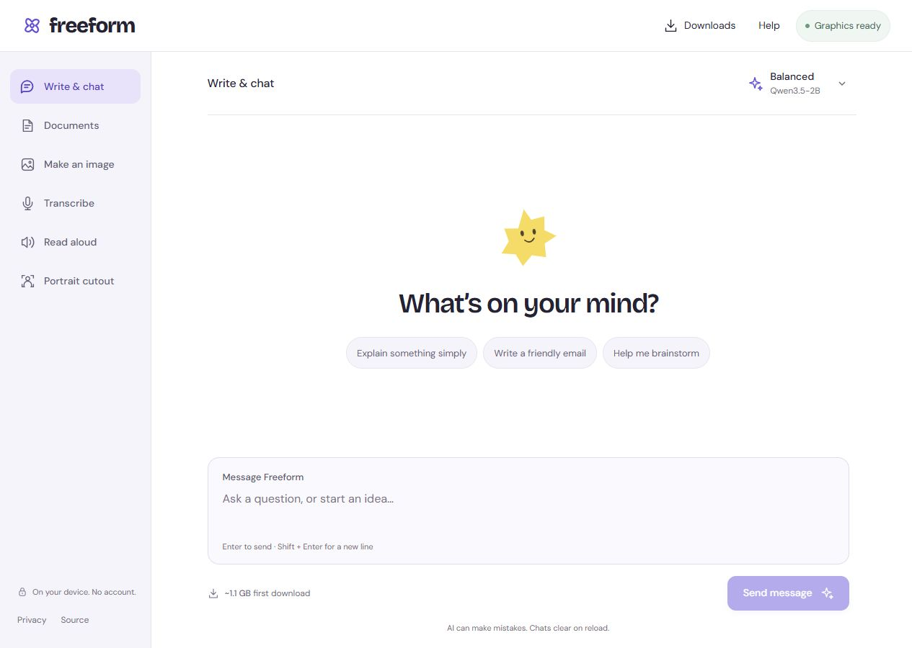

<div align="center">

# Freeform

### A little space for your ideas. AI that runs on your device.

Free, open-source AI chat, document questions, images, transcription, speech, and portrait cutouts — in your browser. No account. No API key. No inference server.

[Try Freeform](https://freeform-local-ai.freeform-ai.workers.dev) · [Model catalog](docs/MODELS.md) · [Privacy](PRIVACY.md) · [Contribute](CONTRIBUTING.md)

[](https://github.com/YG99999/freeform-ai/actions/workflows/check.yml) · [MIT licensed](LICENSE)

</div>



[Phone layout](docs/images/freeform-mobile.png) · [What was actually tested](docs/VALIDATION.md) · [Text quality checks](docs/TEXT-QUALITY.md)

## What you can do

| Tool | What happens locally | Model |
| --- | --- | --- |
| Write & chat | Stream a reply and continue the conversation | SmolLM2 / Qwen3.5 |
| Documents | Read PDF, DOCX, TXT or Markdown; ask about matching excerpts with sources | The selected text model |
| Make an image | Generate a 256px or 512px PNG on WebGPU | FLUX.2 Klein 4B, streamed int4; [real example](docs/images/image-example.png), experimental |
| Transcribe | Upload audio; export text or SRT subtitles | Whisper tiny / base / small |
| Read aloud | Turn English text into a playable, downloadable WAV | SpeechT5 |
| Portrait cutout | Remove a person's background; save a transparent PNG | MODNet |

Model files download directly from Hugging Face after you accept the size. Compiled WebLLM model libraries come from MLC's GitHub repository. Prompts, files, and results stay in the browser. Fonts and WASM runtimes are served with the site.

**Free does not mean infinite hardware.** There are no per-use charges or credits. Your device supplies RAM, GPU memory, storage, power, and network data. Small models make more mistakes. Larger models can be slow, fail to fit, or crash a browser tab. Nothing here guarantees suitability for important decisions.

## Start locally

Use Node.js 22.12+ (Node 24 recommended).

```sh
npm ci
npm run dev
```

Open the localhost URL printed by Vite. Model inference requires HTTPS or localhost. No `.env`, API keys, or backend service is required.

```sh
npm test              # input limits, retrieval provenance, exports, catalog precision paths
npm run check:models # network check of pinned model configs and compiled libraries
npm run build
npm run preview
```

## Host on Cloudflare for free

This is a static website. Cloudflare Workers Static Assets serves it without a Worker function, database, or Workers AI binding. Static-asset requests are free and unlimited under [Cloudflare's published limits](https://developers.cloudflare.com/workers/static-assets/billing-and-limitations/). Hosting limits and provider policies can change. Model downloads use Hugging Face's infrastructure and are subject to its availability and rate limits.

```sh
npx wrangler login
npm run deploy
```

Change `name` in `wrangler.jsonc` for your own deployment. The first deployment may ask you to choose a `workers.dev` subdomain. To use Cloudflare's Git integration instead, connect your fork, use `npm run build`, and set `dist` as the static asset directory. Set your own canonical URL with `SITE_URL=https://your-address` when building.

`public/_headers` provides CSP, COOP/COEP, and privacy headers. The build bundles matching CPU WASM runtimes below Cloudflare's 25 MiB asset limit. WebLLM and FLUX provide their own GPU kernels. Model weights are **never** bundled or proxied through Cloudflare.

## Browser and device support

- CPU text, audio, and cutout tools use WebAssembly. Graphics text and image generation require a working WebGPU adapter. An updated Chrome or Edge is a practical starting point; browser, OS, driver, and hardware support varies.
- Image generation additionally needs OPFS browser storage and several GB of space. The int4 pipeline trades speed for lower GPU memory use. Its first generation can take minutes.
- The graphics check does not measure free VRAM. Download sizes are not memory requirements. No invented quality scores or device-fit promises are shown.
- Browser caches can be evicted. Private browsing may refuse large files or clear them immediately. Downloads are tied to the website's origin and browser profile.
- The app page requires a connection to open. This release does not install an offline service worker. Cached models may be reused once the page is open.
- Documents: 15 MB; PDF up to 100 pages; 180,000 readable characters. Scans require OCR elsewhere. Questions use word-matched excerpts, not an exhaustive reading of the file.
- Audio: 40 MB / 10 minutes per clip; codecs depend on the browser. Transcripts can hallucinate on noise or silence. No speaker diarization.
- Speech: English, one preset speaker, up to 1,200 characters per request. Portrait removal is designed for people, not arbitrary products.
- Text context is intentionally short (4,096 tokens for GPU models; recent conversation is selected conservatively). It is not an internet search tool, agent, or large-document reasoning service.

## Architecture

Vite + native HTML/CSS/JavaScript. One inference Worker is active per tab. Changing models or pressing Stop terminates the Worker, releasing its models. Each runtime is imported only when needed. File extraction runs locally; document search uses lightweight lexical matching with page provenance. Generated Markdown is sanitized with a strict allowlist; model output cannot insert links, images, or scripts.

```text
Cloudflare static site → visitor's browser
                             ├─ download compatible weights from Hugging Face
                             ├─ cache models in CacheStorage / OPFS
                             ├─ run WebLLM / Transformers.js / FLUX locally
                             └─ display, copy, and download results
```

There is no server-side prompt or file upload endpoint. See [privacy and network behavior](PRIVACY.md), [model provenance](docs/MODELS.md), and [release validation](docs/VALIDATION.md).

## Help this grow

Bug reports with the tool, model, browser version, operating system, and error text are useful. Keep private documents, prompts, account details, and tokens out of public issues. Model additions need an actual supported browser runtime, license review, size measurements, and device tests. See [CONTRIBUTING.md](CONTRIBUTING.md).

## License

Website code: [MIT](LICENSE). Models keep their own licenses. Weights are fetched from the publishers, not redistributed in this repository. Third-party runtime notices are in [THIRD_PARTY_NOTICES.md](THIRD_PARTY_NOTICES.md). Freeform is independent of Hugging Face, Cloudflare, and the model authors.
